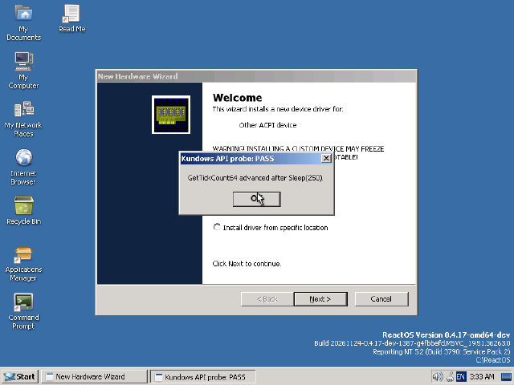

# Choosing the Windows DLL export level

Kundows selects `DLL_EXPORT_VERSION=0x600` (Vista-era exports). ReactOS
`4fbbefd614b` defaults to `0x502` (Server 2003). Its
[MSVC CI matrix](../../../Upstream/ReactOS/Source/.github/workflows/build.yml)
includes `0x600` for i386 and amd64 Debug, using Ninja. CI coverage is a
useful baseline, not a boot test of our VS-generated solution.

## What the switch controls

The [MSVC build](../../../Upstream/ReactOS/Source/sdk/cmake/msvc.cmake)
passes the version to `spec2def` for DLL exports and matching import
libraries, unless a module explicitly specifies its own version. The
top-level CMake also defines `DLL_EXPORT_VERSION` for target code; individual
libraries, kernel paths and even the set of packaged DLLs use it.
`WINVER` and `_WIN32_WINNT` still default to `0x502`. Changing the export
level does not implement a newer kernel ABI or change the OS into Windows 10/11.

## Measured on x64 Debug

Using the project's actual `spec2def --ms -a=x86_64 --dbg`, these are the
distinct export names in the generated `.def` files at the same source pin:

| Export level | `ntdll` | `kernel32` |
| --- | ---: | ---: |
| `0x502` | 1,372 | 986 |
| `0x600` | 1,812 | 1,227 |
| `0x601` | 1,819 | 1,262 |
| `0x603` | 1,820 | 1,270 |
| `0xA00` | 1,827 | 1,271 |

More names do not mean a superset. `GetTickCount64` is present at `0x600`.
The x64 `kernel32` names `ConsoleIMERoutine`, `GetCPFileNameFromRegistry` and
`NlsConvertIntegerToString` disappear above `0x600`; software importing one
by name from that DLL can stop loading. Conversely, `SetThreadDescription`
appears in `kernel32` at `0xA00`. See the [version ranges in the spec](../../../Upstream/ReactOS/Source/dll/win32/kernel32/kernel32.spec).

The isolated `0xA00` VS build linked `ntdll`, `kernel32`, `d3d12` and
`d3d12core`; `ntdll` and `kernel32`'s PE exports matched the table. Both
exports in [d3d12core.spec](../../../Upstream/ReactOS/Source/dll/directx/wine/d3d12core/d3d12core.spec)
are stubs. For example, the generated body of `D3D12GetInterface` raises a
noncontinuable unimplemented-function exception. The DLL being present or
`GetProcAddress` succeeding is insufficient. At `0x600` there are stubs too,
including ALPC entries in `ntdll`.

There is also a system-internal compatibility cost. The legacy
[BaseSrv NLS section path](../../../Upstream/ReactOS/Source/subsystems/win/basesrv/nls.c)
looks up ten `kernel32` functions by name and returns an error if any lookup
fails. All ten are exported at `0x502`; seven of those names are absent at
`0x600`, and nine at `0xA00`. This identifies a particular delay-load path
that cannot resolve its dependencies; it does not imply every locale API or
the entire OS fails to start.

For a newer application, identify its missing import, verify the
implementation and its host/kernel dependencies, and run an application or
behavioral test. Use a separate build tree for wider export-level experiments
so that DLLs and import libraries from different levels cannot be mixed.

## Installed guest at `0x600`

The stock-branded x64 Debug solution built 1,419 projects with zero failures.
The BootCD (`9E2A967AE0004DE2785E42D976FA951A26519A220AC30EA020D862BB5BFC3DCB`)
contained the measured 1,812 `ntdll` and 1,227 `kernel32` exports. On Hyper-V
Gen 1 it completed a blank-disk FAT installation, rebooted through graphical
Setup and reached a desktop that responded to guest Ctrl+Alt+Del.

A native x64 program on a separate read-only test CD statically imported
`kernel32!GetTickCount64`. The installed loader resolved the import and
the returned count advanced across `Sleep(250)`.

