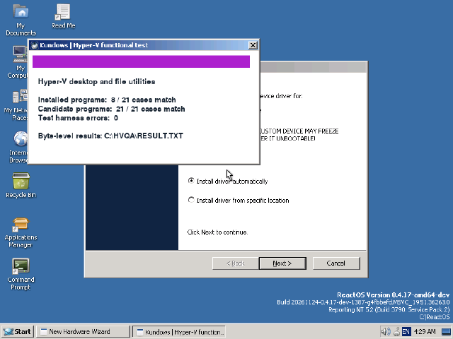

# Hyper‑V 安装与桌面实测：启动故障与四项应用问题

2026-11-25 测试从空盘安装的 x64 Debug，`DLL_EXPORT_VERSION=0x600`，ReactOS 固定在 `4fbbefd614b218afd3f0cbf09aa32998ea3ad7a6`。BootCD SHA-256 为 `9E2A967AE0004DE2785E42D976FA951A26519A220AC30EA020D862BB5BFC3DCB`。测试机为 Hyper‑V Gen 1，1 个虚拟 CPU、1 GiB 内存、8 GiB IDE 磁盘，英文界面，无网卡。

## 决策清单

同一镜像做了两次独立的 FAT 快速格式化安装。第一块盘在图形安装前卡住；第二块盘用默认启动项正常装到桌面。以下应用结果都来自**第二块盘已安装的系统**。四个候选 EXE 用相同的固定源码、MSVC、x64 Debug 和 `0x600` 在隔离树构建，通过只读测试光盘并排运行。没有替换来宾系统文件。

| 项目 | 实际影响 | 原版 → 候选通过数 | 难度、本库建议 | 上游建议 |
| --- | --- | ---: | --- | --- |
| 安装后首次硬盘启动 | 同一故障盘的 Debug 入口灰屏，普通入口蓝屏；FAT32 两份分配表不一致 | 当时仅修字体链，普通入口进入向导；另一次只修显示器关系查询，越过原故障后在后续 IOCTL 断言 | [G1 已修、G4 已定位](Review/Verified.md)；最初的 FAT 写坏路径仍待定位 | 建议分开反馈显示请求的完成缺陷与磁盘实证 |
| SORT | 没有末尾换行时，最后一个字符被静默删除，退出码仍是 0 | 3/5 → 5/5 | **低**；默认启用[末行修复](../../../Upstream/ReactOS/Patches/Runtime/ReactOS-sort-eof.patch) | 建议独立报修 |
| WHERE | 显式限定目录却命中当前目录；`/Q` 可能返回假成功 | 1/5 → 5/5 | **低**；默认启用[范围修复](../../../Upstream/ReactOS/Patches/Runtime/ReactOS-where-scoped.patch) | 建议独立报修 |
| FINDSTR | `/B`、`/E`、`/X` 对普通单词退化成子串匹配，`/V` 还可能给错退出码 | 1/7 → 7/7 | **保留候选**；[短行补丁](Candidates/findstr-anchors.patch)把缓冲区边界当行首/尾；见[新增反例](Review/Verified.md#findstr边界反例) | 先与已有 FINDSTR 工单协调范围 |
| 记事本 | 文件以 LF 为主，编辑一个字符并保存，却把所有行改成 CR | 3/4 → 4/4 | **低**；默认启用[换行选择修复](../../../Upstream/ReactOS/Patches/Runtime/ReactOS-notepad-majority-eol.patch) | 建议按行为回归反馈，附引入变更和输入字节 |

**合计 8/21 → 21/21**；13 个失败用例归于上表的四个应用问题。17 个命令行用例另用 Windows（build 26300）自带程序核对过输出字节和退出码。4 个记事本用例实际启动 GUI、读取编辑框、输入 `!`、执行“保存”并重读文件；依据是 ReactOS 的换行选择逻辑。每个原版应用的哈希都与安装介质相符。

[21 项逐项输出和退出码](Results.tsv)；测试盘 SHA-256：`6D655F1D43CCD49A4C464C522FB35D6B923B49891B3E1DEABE60C3DB4ADB0021`。来宾结果文件是在正常关机后从只读磁盘副本取回的（SHA-256：`842926E17F573328BF3CA18870451425EB50A7B1D67C875B1A08A4A4D59D8E9A`）。这是改动接入前的并排测试；后续的[接入决定与验证记录](Review/Verified.md)另列。未向上游提交工单。

另行验证通过：Shell 文件操作可以复制、改名并删除中文文件名，复制内容不变；来宾 Ctrl+Alt+Del 有响应，正常关机后在 DVD 和软驱都为空时能从硬盘冷启动。随后在[资源管理器](Images/cold-explorer.png)看到测试文件，用[安装版记事本](Images/cold-notepad.png)重新打开之前保存的文件，末行的 `!` 仍在。此轮未测网络、UEFI 或其他架构。

## 如何复现

下列输入中的 `\r` 和 `\n` 分别代表字节 `0D` 和 `0A`。在宿主运行 `python make-inputs.py HVQA` 即可用[样本生成脚本](make-inputs.py)准备精确字节，再把新目录复制到来宾的 `C:\HVQA`。以下命令在来宾的 `cmd.exe` 中运行；测试记事本前另存一份可写的 `mixed.txt`。

### 1. SORT：最后一行没有换行时丢失字符

- 写入 `list.txt`，内容为 `zebra\r\nalpha`，末尾没有换行。运行 `sort < list.txt > sorted.txt`。正常输出是 `alpha\r\nzebra\r\n`；单字符文件 `Q` 也应保留该字符。
- [固定版 `sort.c`](../../../Upstream/ReactOS/Source/base/applications/cmdutils/sort/sort.c)：读完每行都把最后一个字符改为零，未检查它是否真是换行。候选只剥掉实际读到的 `\n`。范围为当前读取缓冲区内的文本；不改变排序规则或长行限制。
- 影响是**静默改写数据**，命令仍可返回成功。适合单独回补，并以普通 CRLF、空输入、逆序和单字符输入作回归测试。

### 2. WHERE：指定目录也会返回当前目录的文件

- 在 `C:\HVQA\Work` 与 `C:\HVQA\Scope` 各建一个 `review.qa`，另在 `Work` 下建 `onlycwd.qa`。进入 `Work`，执行 `where C:\HVQA\Scope:review.qa`。应只出现 `Scope\review.qa`。
- 执行 `where /Q C:\HVQA\Scope:onlycwd.qa`，并单独执行 `echo %errorlevel%`：指定目录没有该文件，期望为 `1`。还应测试 `set QADIR=C:\HVQA\Scope` 后的 `where $QADIR:review.qa`；普通 `where review.qa` 仍须搜索当前目录和 `PATH`。
- [固定版 `where.c`](../../../Upstream/ReactOS/Source/base/applications/cmdutils/where/where.c)：`WhereFindByDirs` 无条件把当前目录放到搜索列表开头。候选仅在无显式范围时使用这种行为；即便变量名恰为 `PATH`，显式 `$PATH:` 仍是限定范围。
- 影响是脚本的存在性检查得到假阳性。与当初添加工具的 [CORE-17443](https://jira.reactos.org/browse/CORE-17443) 是不同问题。

### 3. FINDSTR：接受位置开关，却仍按子串筛选

- 写入 `colors.txt`，内容为 `red\r\ntired\r\nred fox\r\nredred\r\n`。分别运行 `findstr /B red < colors.txt`、`findstr /E red < colors.txt`、`findstr /X red < colors.txt`。三者应分别输出 3、3、1 行；整行匹配只应返回 `red`。
- [固定版 `findstr.c`](../../../Upstream/ReactOS/Source/base/applications/findstr/findstr.c)：参数解析器设置三个标志，实际匹配却始终调用 `strstr`。候选在比较已读文本时应用行首、行尾、整行条件；行尾直接比较后缀，所以 `redred` 能按行尾正确命中。
- 候选只处理**单个普通模式、可完整读入的一行**。固定版的正则、多模式和跨缓冲区长行问题不在此修复内。若上游准备整体改写匹配器，优先给它回归用例，避免维护两种匹配逻辑。[CORE-15767](https://jira.reactos.org/browse/CORE-15767) 涉及管道和 `/C:`；本例用文件重定向和不含正则元字符的模式，可独立复现。

### 4. 记事本：混合换行文件保存时选择了少数格式

- 打开内容为 `A\nB\nC\nD\rE` 的文件：3 个 LF、1 个 CR。在最后一个 `E` 后输入 `!`，保存。检查输出字节；只看编辑区无法区分换行格式。
- [固定版 `text.c`](../../../Upstream/ReactOS/Source/base/applications/notepad/text.c)：选择保存格式时先比较 CR 与 CRLF，只要 CR 更多就选 CR，即使 LF 明显更多。候选再比较 LF 的计数，不改变固定版的平局优先级。
- 这是 ReactOS 自身的行为回归：[优化 `0a851eadcb7`](https://github.com/reactos/reactos/commit/0a851eadcb7) 之前，代码以当时最高计数为基准逐项比较。这里建议恢复**严格多数**时的行为；对于平局，是否完全恢复更早的优先级可另议。不能由此断定 Windows 的所有记事本版本都采用同一策略。[CORE-754](https://jira.reactos.org/browse/CORE-754) 是当初增加多种换行支持的已解决工单。

## 上游核对

测试时读取了 ReactOS 官方 [`master` 的精确版本 `a3772c9df2a1`](https://github.com/reactos/reactos/tree/a3772c9df2a1a6f486cf957721956b18ebb19776)。以上四个 `.c` 文件均与本库固定的上游版本逐字节一致。运行证据取自固定版；未运行该 `master` 的整套镜像。公开问题检索只用于定位相关工单，不能证明无人报告过相同问题。

## 安装故障：首次硬盘启动灰屏或蓝屏

以下是原版安装现场。[初次走查](Review/README.md)记录了调查起点；[后续验证](Review/Verified.md)记录了从同一现场读出的 IRP、真正的蓝屏原因、各项独立修复与新安装结果。

两次均设 IDE 硬盘优先，让空盘回落到 DVD。选择文本安装、FAT 快速格式化、安装 MBR 和 VBR，按画面完成安装步骤；保留应答软盘至首次桌面。第一次文本安装完成并重启。硬盘 FreeLdr 自动选择 `ReactOS (Debug)` 后，屏幕至少连续四分钟呈灰色，六分钟内没有等到图形向导。在同一块盘上重新冷启动，默认入口再次灰屏六分钟。测试机没有连接串口调试器。保存现场后，从只读磁盘副本核对了 813 个已安装 PE，全部与这张光盘或 CAB 中的输入匹配，没有无法读取的 PE。

Debug 入口的 CPU 快照位于 `kdcom.dll!Cp16550ReadLsr+0x52`；栈上的可能返回地址落在 `KdReceivePacket`、`KdSendPacket`。同一磁盘改选普通 `ReactOS` 入口，出现[可读的蓝屏](Images/first-disk-stop.png)：`KMODE_EXCEPTION_NOT_HANDLED (0x1E)`，异常 `STATUS_ASSERTION_FAILURE (0xC0000420)`。时间戳与发布镜像的 `ntkrnlmp.exe` 相符。断言位于 AMD64 的 `KiGeneralProtectionFaultHandler+0x169`；用重建 PDB 定位前，已核对该函数的起止 RVA 及全部机器码与发布内核一致。从保存现场取回的外层陷阱帧指向 `win32k.sys`。因此不建议用“缩短串口等待”或“删除断言”作为本问题的修复。

故障盘的 FAT32 簇为 4,096 字节，两份 FAT 相差 **29 个表项**。`\ReactOS\Fonts\PALAI.TTF` 长 278,228 字节，应占 **68 簇**，活动 FAT 中只有 **1 簇**，后继指向空闲项。后一次快照中 `PAGEFILE.SYS`、`SYSTEM.ALT` 的链也不完整。这是文件系统层的证据；只校验 EXE/DLL 会漏掉它。采样发生在故障及重启之后，不能仅凭这些数据把最初的损坏归到 FAT 驱动、CC 或 MM 中的某一个。

**蓝屏的原始故障位置。** 陷阱帧的 `win32k.sys` 地址对应 `EngpUpdateMonitorDevices+0xD0`。重建版与发布版该函数的起止 RVA 和全部机器码一致；PDB 将现场映射到[固定版 `win32ss/gdi/eng/device.c:584`](https://github.com/reactos/reactos/blob/4fbbefd614b218afd3f0cbf09aa32998ea3ad7a6/win32ss/gdi/eng/device.c#L584)，即显示器枚举时读取 PnP 设备关系的 `Count`。该源文件与前述上游 `a3772c9df2a1` 逐字节一致。后续核对发现：驱动构造的 `Count` 确实为 1，但调用方拿到的指针还是 Debug 填充值。

**修复对照。** 对故障盘做独立的平面副本。第二份 FAT 中该字体的 68 簇可完整读出，278,228 字节与原盘安装 CAB 的 `palai.ttf` 逐字节一致（SHA-256 `3234C7CA0DC4F260A61E7E27827C84E8C44FD36CC7FFC09C1D2F67E8987CDCE9`）。在离线副本上只恢复该链缺失的 29 个表项，两份 FAT 随即一致。没有更换字体数据、注册表或系统程序，也没有修补另外两条链。随后从副本读出的 51 个字体文件都与 CAB 一致。

| 同一台 VM 的启动项 | 故障盘 | 修复该字体簇链后的副本 |
| --- | --- | --- |
| 普通 `ReactOS` | `STOP 0x1E` | [进入图形安装向导](Images/first-disk-repaired-gui.png)；此轮验证到欢迎页。 |
| 默认 `ReactOS (Debug)`，无串口调试器 | 两次均未进入向导，灰屏 | 六分钟内仍未进入向导。 |

这给出了普通启动项的实测恢复路径，但不能据此认定 Debug 灰屏已修好，也还不能定位最初写坏 FAT 的代码。完整安装到桌面、冷启动和 21 项应用测试用的是**另一块未经修盘的新装磁盘**。

上游有症状相关的 [CORE-17172](https://jira.reactos.org/browse/CORE-17172)（真机第三阶段 FAT32 损坏）和已解决的 [CORE-17587](https://jira.reactos.org/browse/CORE-17587)（旧版 x86）。两份报告的环境和停止码不等同于本例，反馈前应先核对是否共因。交给上游时应注明使用的是 Kundows 镜像，列出本库已有的内核补丁；特别是 [CC 缓存写回修复](../../../Upstream/ReactOS/Patches/Runtime/ReactOS-cc-pinned-dirty.patch)已启用，[MM 可选修复](../../../Upstream/ReactOS/Patches/Runtime/ReactOS-mm-flush-collision.patch)未启用。

后续已在**文本安装完成、首次进入图形阶段前**保留只读样本，对照两份 FAT、目录要求的链长和 CAB 中的字体，见[修后验证](Review/Verified.md)。要判断最初两个 FAT 副本在哪次写入分歧，仍需同一批脏扇区各自的写入完成记录。一次安装成功不足以判定写回问题消失。
