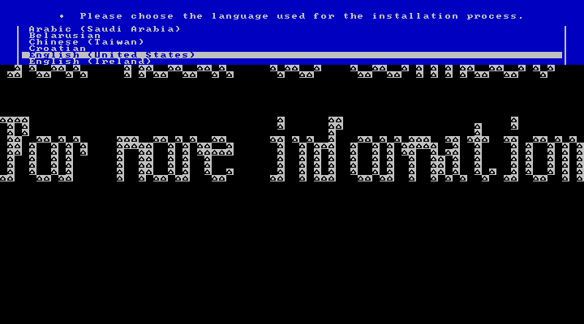
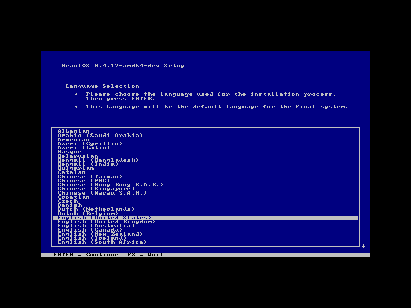
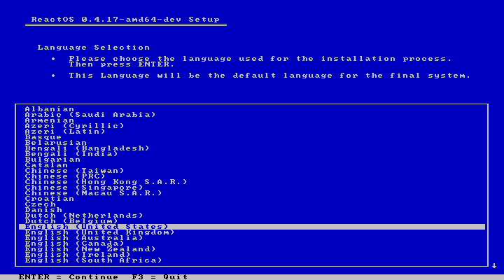

# EFI Setup text was clipped on VBoxVGA

[SetupBootFramebuffer.patch](SetupBootFramebuffer.patch) keeps first-stage Setup on the boot framebuffer when the loader supplies one. The installer still sees an 80×50 text console. BIOS Setup without that resource still uses VGA text mode.

## Same media, different display drivers

VirtualBox **7.2.22 r175245**, x64 Debug, one CPU, 1 GiB, IDE DVD, no hard disk, network or serial port; 3D and remote display off. Both images use the same generated BootCD file list and boot directly to **ReactOS Setup (Text Mode)**. The control substitutes `blue.sys` and `lfbbvid.dll` built from unmodified display sources at `4fbbefd614b`. The historical PCI workaround is absent from both.

| Guest | Result at language selection |
| --- | --- |
| Stock drivers, EFI64 + VBoxVGA | Clipped. `info vga all`: text mode 80×50, `cbLine: 0xc80`. Screenshot byte-identical to the 7.1.10 failure below. |
| Patched drivers, EFI64 + VBoxVGA | Readable; VBox kept its **800×600×32** scanout, `cbLine=0xc80` (3,200 bytes). Down moved the highlight from English (United States) to English (United Kingdom). |
| Same patched ISO, EFI64 + VMSVGA | 800×600×32, same pitch. Both the language page and the screenshot after Down were byte-identical to the patched VBoxVGA captures. |
| Same patched ISO, BIOS + VBoxVGA | Readable; hardware text mode 80×50, `cbLine: 0x280`. Down moved the highlight. |

| Stock EFI | EFI using the boot framebuffer |
| --- | --- |
|  |  |

[Same EFI page after Down](Assets/SetupBootFramebufferAfterDown.png). These runs stop at language selection; they do not establish a full installation. The replacement was not run on 7.1.10. Test ISO SHA-256: stock `8c38cfaafea8fa0bb407dade444ad5810a7f28549a2f4bd28dc718d42055663e`; patched `a4e76624fddff801655ac00f0051fc5057a5127098a49be5d3ef26f6e69d848c`.

## Hyper-V verification

The same ISOs were booted on Windows build 26300.9974, Hyper-V VM configuration 12.0, with one vCPU, 1 GiB of fixed RAM, DVD only, no network and no serial connection. Frames and keyboard input came from the Hyper-V CIM provider.

| Guest | Result |
| --- | --- |
| Gen 1 (BIOS, IDE DVD), patched | The full [640×400 language page](Assets/HyperVGen1Setup.png) was readable, including the bottom action bar. [After one Down key](Assets/HyperVGen1AfterDown.png), the selection moved from English (United States) to English (United Kingdom). The legacy text path passed. |
| Gen 2 (UEFI, SCSI DVD, Secure Boot off), stock and patched | Restoring the same powered-off checkpoint before each boot produced [the same 1024×768 stop screen](Assets/HyperVGen2Io1Stop.png): `IO1_INITIALIZATION_FAILED` (`0x69`, all four arguments zero). The PNGs were byte-identical. Neither boot reached language selection. |

A saved state from a repeat Gen 2 boot shows where the patched display path stopped. The loaded kernel and display drivers matched the DVD's CodeView IDs. `bootvid.dll` was `lfbbvid.dll`, with a mapped **1024×768×32** framebuffer and a **4,096-byte pitch**. `blue.sys` had selected the framebuffer (`BootText` present), but `Requested` and `Enabled` were both zero. **Resource discovery is verified on Gen 2; Setup drawing and input are not.**

At the stop the loader named `multi(0)disk(0)cdrom(0)`, while the I/O manager reported zero CD-ROM devices and zero SCSI ports. The pin [raises `0x69` when `IoInitSystem` returns false](https://github.com/reactos/reactos/blob/4fbbefd614b/ntoskrnl/ex/init.c#L1856); the exact failing I/O operation was not captured.

## Historical reproduction and workaround (7.1.10)

The pre-rework x64 Debug image used for comparison is the one that completed
a hard-disk installation in the Hyper-V Gen 1 matrix (SHA-256
`9398249C4C4C2391BBE56FE86CC51B180CD6D57BD77FDFC4659A69499EA86432`).
The CMake/VS control is the default x64 Debug ISO from `973eafc` (SHA-256
`71FA8B3F81B9EF1651C2F84B38ACFA05FFA08C7FCC5297E48252BC6140879555`).

The original captures used VirtualBox 7.1.10, one CPU, 1 GiB of RAM,
VBoxVGA, an IDE DVD, no network, no serial ports and no hard disk. After
selecting **ReactOS Setup (Text Mode)**, the visible language page was
compared with the VGA and VBE state and the text-memory view.

| Media | Firmware | VGA state / text-memory view | Visible result |
| --- | --- | --- | --- |
| Pre-rework Debug | BIOS | 80×50 / 80 columns; VBE disabled | Readable Setup |
| Pre-rework Debug | EFI64 | 80×50 / 400 columns; 3,200-byte VBE pitch | Clipped text and stale pixels |
| CMake/VS Debug control | EFI64 | 80×50 / 400 columns; 3,200-byte VBE pitch | Identical to pre-rework EFI64 |
| CMake/VS Debug with the retired workaround | EFI64 | 80×50 / 80 columns; VBE disabled | Readable Setup |

The two corrupted EFI screenshots were byte-identical. The `blue.sys`
source was also identical at the two ReactOS pins (`1103f43a0c0` and
`4fbbefd614b`). On this adapter the firmware left its 800×600×32 VBE
framebuffer enabled. Setup's `blue.sys` programmed legacy VGA text
registers, but the emulated display still fetched rows using the graphics
pitch. This explains why the language list was present in guest memory
and nevertheless unreadable on screen.

The [retired driver patch](Assets/BlueVBoxVBE.patch) detects
the VBoxVGA PCI adapter (`80ee:beef`, VGA class, I/O decoding enabled) and
disables the extended mode while `blue.sys` owns the text console. In the
published x64 Debug test image (`209008C7335C311DB636E128418DE58A240506D5E5B61AAE452E54EB35B7C57C`),
`info vga` reported `cbLine: 0x280`, versus `0xc80` before the fix.

| Before the workaround | After disabling VBE |
| --- | --- |
|  |  |

## Where the display handoff differs

FreeLdr passes the [address, pixel format and scan-line pitch](https://github.com/reactos/reactos/blob/4fbbefd614b/boot/freeldr/freeldr/arch/uefi/uefivid.c#L541-L550) in a [boot display resource](https://github.com/reactos/reactos/blob/4fbbefd614b/boot/freeldr/freeldr/arch/uefi/uefihw.c#L251-L282). The loader can [select `lfbbvid.dll` from that resource](https://github.com/reactos/reactos/blob/4fbbefd614b/boot/freeldr/freeldr/ntldr/winldr.c#L682-L731). The break comes later: [usetup opens `BlueScreen` and enables it](https://github.com/reactos/reactos/blob/4fbbefd614b/base/setup/usetup/console.c#L77-L109); stock [`blue.sys` programs VGA mode 3](https://github.com/reactos/reactos/blob/4fbbefd614b/drivers/setup/blue/blue.c#L411-L420) and [maps the legacy text aperture](https://github.com/reactos/reactos/blob/4fbbefd614b/drivers/setup/blue/blue.c#L555-L566). A pixel buffer cannot be substituted for that array of character/attribute pairs.

Microsoft [documents](https://learn.microsoft.com/en-us/windows-hardware/drivers/display/microsoft-basic-display-driver) that BasicDisplay inherits the boot linear framebuffer on UEFI. Its [public KMDOD sample](https://github.com/microsoft/Windows-driver-samples/blob/16022c5/video/KMDOD/bdd.cxx#L80-L85) uses `DxgkCbAcquirePostDisplayOwnership` and [maps the physical address and byte count](https://github.com/microsoft/Windows-driver-samples/blob/16022c5/video/KMDOD/bdd_dmm.cxx#L728-L733).

The [actual x64 driver examined in IDA](Assets/IDABasicDisplay.txt) queries `DxgkServicesBDD` and uses a callback in the returned interface. On the inherited-mode branch it maps the supplied physical address for `Height * Pitch` bytes and propagates mapping failures. It has other paths, including firmware checks and BIOS mode setting. The sample is not the shipping binary; neither is a source match for ReactOS's NT 5.2 text console. These static observations do not establish a Windows-wide absence of VirtualBox quirks.

## How Setup uses the resource

1. `blue.sys` is a [Setup boot driver](https://github.com/reactos/reactos/blob/4fbbefd614b/boot/bootdata/txtsetup.sif#L93). `DriverEntry` checks the console display's device-specific resource while the loader block still exists. No loader pointer survives into user-mode Setup.
2. `lfbbvid` keeps the physical mapping it made during [boot video initialization](https://github.com/reactos/reactos/blob/4fbbefd614b/drivers/base/bootvid/framebuf/bootvid.c#L137-L230). `blue` keeps the character/attribute grid in nonpaged memory and sends changed 8×8 glyphs to the active BOOTVID through `VidBufferToScreenBlt`. The framebuffer driver uses the firmware pitch and pixel masks. No new kernel export or second video-memory mapping is needed.
3. The existing INBV callback can run at `HIGH_LEVEL`. On this path it disables presentation and keeps the cells and font in memory. Reacquisition repaints them; an explicit disable cancels the request. VGA register, cursor and font-plane writes stay on the legacy path. This is a ReactOS text-console adaptation, confined to first-stage Setup; it is not a WDDM port.

Run the [host case](Tests/Run.cmd) from a native VS developer prompt after applying the patch:

```bat
Upstream\ReactOS\Patches\Graphics\VBoxVGATextMode\Tests\Run.cmd
```

The case compiles the checkout's console reset/write, glyph renderer and BOOTVID blit code with the current `cl`. It checks BGRX and RGBX, an 800-pixel row with an 832-pixel pitch, the last cell and row padding, color attributes, font reload, cursor movement, bottom-row scrolling, and loss/reacquisition/explicit disable. INBV notifications are modeled; the guest tests do not trigger a bugcheck.

The case passed in x64 and x86 VS developer prompts. Both driver targets built for x64 Debug and Win32 Release. ARM64 Debug generates its solution and the import definition for the loader's `bootvid.dll` name, but VS stops assembling the import-library alias (`MSB3721: MASM not supported on this platform`). The existing `liblfbbvid` target hits the same error. No ARM64 driver or guest result is claimed.

## Updating a checkout with the retired workaround

Before applying the current series, check whether **the exact old patch** can be removed. Changing `Series.tsv` alone does not undo edits to the submodule. From the repository root:

```bat
git -C Upstream/ReactOS/Source apply --reverse --check ../Patches/Graphics/VBoxVGATextMode/Assets/BlueVBoxVBE.patch
```

If the check succeeds, repeat without `--check`, then run `Configure.cmd` to apply the new series and rebuild. If it fails, inspect `git -C Upstream/ReactOS/Source diff -- drivers/setup/blue/blue.c` before changing that file.
