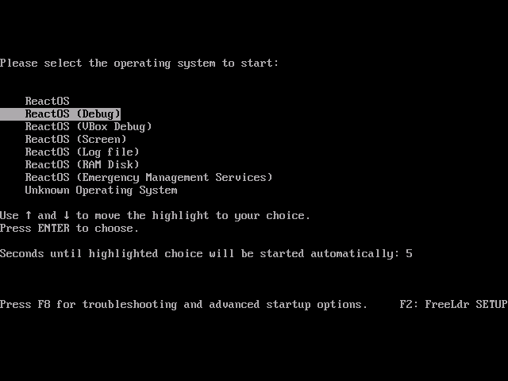
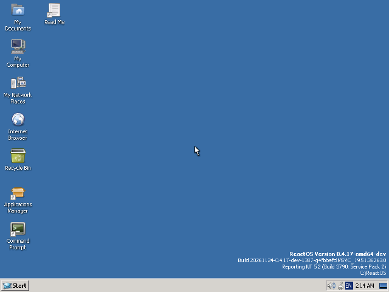
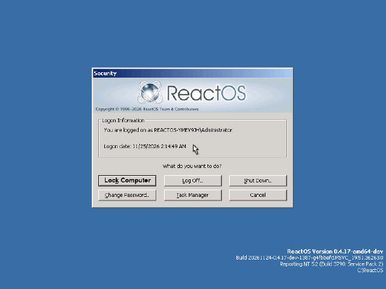

# Historical x64 Debug installation controls

These are shared image and boot observations. The [Hyper-V procedure](../../../../../Docs/windows-reimplementation.md#hyper-v-验证) identifies the fixture and how to restore it.

## Hyper-V Gen 1

The test used the x64 mainline settings: 1 vCPU, fixed 1 GiB RAM, no NIC
or COM connection, and a fresh 8 GiB IDE VHDX. The hard disk was first
in the boot order, so the blank disk fell back to the DVD. In **ReactOS
Setup (Text Mode)** we selected **FAT (Quick Format)** and installed the
MBR and VBR. A separate answer floppy was attached, but Setup still needed
keyboard input in both the text and graphical stages.

With the pinned-cache fix enabled and the MM change still optional, the
default `Configure.cmd`, `Build.cmd`, `MakeISO.cmd` sequence produced
`OutDir\bootcd-x64-Debug.iso` (SHA-256
`7D92E350127CC0020566DEE555809946EF809989FB765E73962F90B928B8344D`).
The install went from the blank disk through text Setup, the hard-disk
FreeLdr menu, graphical Setup, and Explorer. After a guest-initiated
shutdown, a cold start with **both DVD and floppy empty** reached the
desktop again. A guest Ctrl+Alt+Del opened the ReactOS Security dialog.

**First hard-disk boot**

**Cold boot with the DVD and floppy drives empty**

**Response to Ctrl+Alt+Del**

After another clean shutdown, a read-only disk copy yielded all 1,110 files
under `\ReactOS` (198,183,396 bytes). All 785 installed `.exe`, `.dll`,
`.sys`, `.ocx` and `.cpl` files matched packaged build inputs. The two FAT32
tables were byte-identical, and walking the directory tree found no short
or invalid cluster chains. The fixture was then restored to `Clean-blank-Off`.

## Boot controls

For the x64 Debug control with the I/O fix, before enabling KD/RTC by default
(`02C6FCC59CC6AC0311160E0B605F51DD268D0EB6D0B46315928E86971007BD7B`),
the kernel, Setup executable and text driver inside the ISO matched their
VS outputs. With **ReactOS Setup (Text Mode)** selected, the last visible
output was FreeLdr's COM1 notice. At 4 min 10 s the differencing VHDX was
still at its original 4 MiB size. The banner alone does not identify the
blocking component.

With the I/O fix and all four historical runtime patches (KD, RTC, CC, MM; ISO SHA-256
`DEFD2CE8854628957AE943E3AC1724883221973B14089F7700E518EAF947E78B`),
the same fixture copied files, rebooted to the installed disk's FreeLdr
menu, completed graphical Setup, and rebooted to Explorer. With the DVD
and floppy ejected, a guest Ctrl+Alt+Del opened the ReactOS Security dialog.

The [KD-only and RTC-only controls](../../Kernel/KdAutoProbe/README.md) isolated two separate waits. An earlier [short HAL chain](../../Storage/FAT32SetupHalChain/README.md) was observed after file copying.
