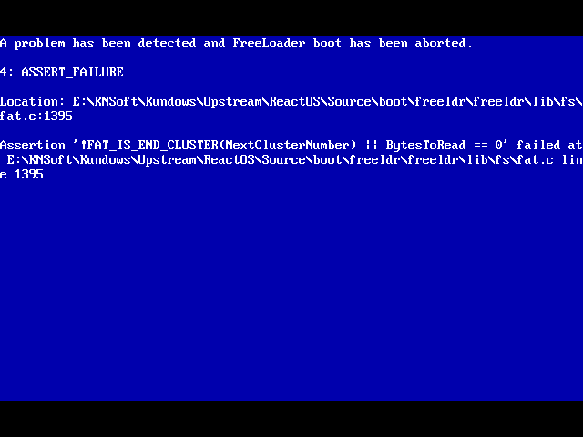

# First disk boot found a short HAL cluster chain

The x64 Debug build with the I/O, serial KD and RTC fixes, but without
the CC/MM changes, produced a BootCD
(SHA-256 `A80DC1D449B3CC0C469AAD4D21FCFF31D0F4D3BE33A59AD768EA87591E62614B`).
MSVC runtime checks and kernel debugging were enabled. All 878 checked
binary and CAB paths in the generated BootCD file list matched their
inputs byte for byte, including Setup, both kernels, both HALs and `kdcom.dll`.
Text Setup completed. On the first hard-disk boot, FreeLdr asserted in
`FatReadFile` (`fat.c:1395`).

Before powering off the guest we saved it
and inspected a read-only disk copy. The two FAT32 tables differed.
`system32\hal.dll` was 403,456 bytes but its chain had one 4,096-byte
cluster instead of 99. The other 785 installed PEs matched packaged inputs.
The installation wrote a damaged file chain; the ISO's HAL was intact.

The `CachePinnedDataTests.c` fixture from `26617bf` ran the production
`pin.c` functions from the current pin with a writeback forced between
marking a pinned buffer dirty and the caller's update. It reported nine
failed checks in nine cases before the CC change and none afterwards.

**Open:** the first wrong write was not captured. The host interleaving and the [successful installation](../../Shared/BootCD/README.md#hyper-v-gen-1) do not establish that it occurred on this disk. The [29 missing font-chain entries](../FAT32InstallMirrorDivergence/README.md) were observed on a different installation.
