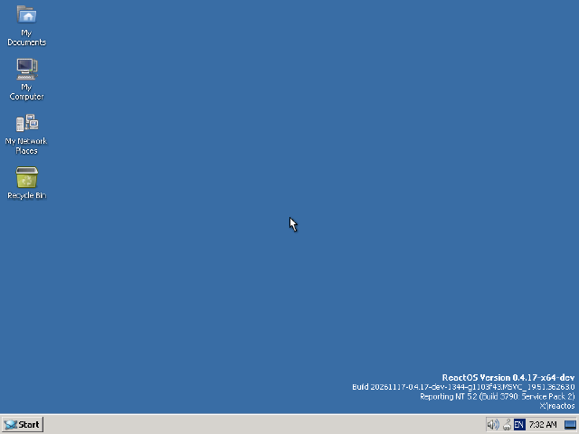
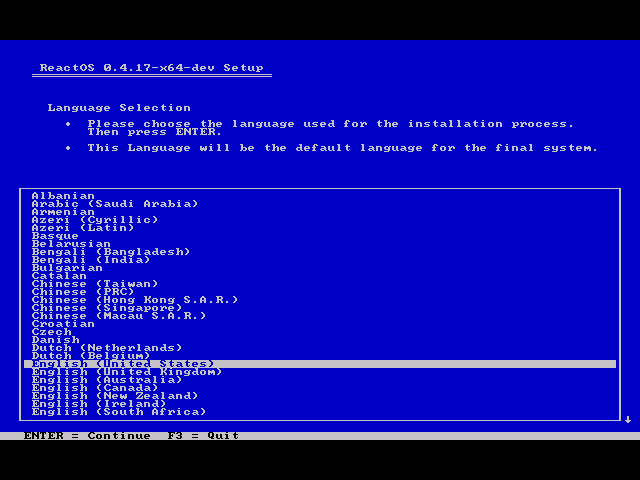

# ReactOS x64 ISO Validation

Updated: 2026-11-22

**Runtime status: disconnected boot checks passed.** Both final images
reached the LiveCD desktop through their default boot entries with both COM
ports disconnected. Debug also reached text-mode setup.
No disk installation has been performed.

## Current canonical images

| Configuration | Bytes | SHA-256 |
| --- | ---: | --- |
| Debug | 246415360 | `A1228E3E0E0801D632CE3080B72641BF7F59BB3F405B1E612687BE28BF0160C0` |
| Release | 203423744 | `2E9A8F73175522C6625A61B33A93604FB5F6530BEA5DD7ED7922BB92E305C486` |

Paths: `OutDir/Images/x64/Debug/bootcd.iso` and
`OutDir/Images/x64/Release/bootcd.iso`.
All compilation and packaging used native MSBuild/PowerShell, not CMake/Ninja.
Release generates `DefaultOS=LiveImg`; Debug retains `LiveImg_Debug`.

## Strict static validation

| Check | Debug | Release |
| --- | ---: | ---: |
| Package declarations | 3273 | 3267 |
| Unresolved inputs | 0 | 0 |
| Raw ISO directory entries checked | 2524 | 2516 |
| Invalid ISO names | 0 | 0 |
| PE images, including resource-only images and packaged FreeLdr payload | 1571 | 1567 |
| Imported symbols | 107550 | 103270 |
| Delay imports (included above) | 1830 | 1814 |
| Imports using forwarded exports (included above) | 8447 | 8427 |
| Exact import/export errors | 0 | 0 |

Exact validation checks architecture, exported names/ordinals, delay imports,
and forwarded exports. No missing DLL or symbol was ignored.
The optional Debug `kdgdb.dll` was rebuilt with MSBuild after the corrected
filename exposed its stale `ntoskrnl.dll` import; it now imports the real
`ntoskrnl.exe`, without adding a fake provider.

## Runtime evidence

VM: `Kundows-x64`, Generation 1, 1 GiB, one active processor, CD-first BIOS.
**COM1 and COM2 paths were empty throughout the disconnected boot tests.**
Menu selections were verified before sending Enter through the Hyper-V CIM
keyboard. No host-window activation or `SendKeys` was used.

- Release: the unchanged default `LiveImg` selection reached the graphical
  language/keyboard page. Choosing **Run ReactOS Live CD**, not Install,
  reached the desktop with icons, taskbar, and Start button.
- Debug: the final `Setup (Debug)` selection reached the text-mode installer's
  language-selection page without an attached debugger.
- Debug was then cold-booted again using its unchanged default
  `LiveImg_Debug` (`Live (Debug)`) selection, with `/DEBUG` still enabled.
  It reached the graphical LiveCD wizard and, after choosing **Run ReactOS
  Live CD**, the desktop. No serial pipe or debugger was attached.

[Release default selection](images/reactos-x64-release-default-menu.png)



[Debug setup selection](images/reactos-x64-debug-setup-menu.png)



[Debug default selection](images/reactos-x64-debug-default-menu.png)


WGC/PrintWindow captures of the existing, occluded VMConnect window sometimes
contained stale black guest content even while ReactOS was running.
Independent Hyper-V guest thumbnails supplied the actual display evidence
without activating the window. A banner, black screen, `Running` state,
zero CPU usage, or a bugcheck was **not** treated as a successful boot.

## Fixes and regression checks

- Release boot defaults are generated separately; the upstream Debug default
  and its debugging options are preserved.
- Actual MSVC Debug uses `_WINKD_`/`kdcom`, not KDBG. Its UART receive polling
  is bounded, and discovery uses two attempts until a KD reply establishes
  a connection. Acknowledged sessions keep normal retries; disconnection and
  reconnection work. Exceptions and debugger prompts are not silently skipped.
  There is no forced-debug mode or FreeLdr ANSI-terminal probe.
- RTC calibration and normal clock initialization install the handler and
  unmask the route before reloading/programming the periodic divider. Clock
  state is initialized before CPU interrupts are restored.
- The packaging adapter resolves `$<TARGET_FILE_NAME:...>` using native
  project outputs and rejects remaining expressions or invalid destinations.
  `Build/TestReactOSIsoLayout.ps1` additionally checks raw ISO directory
  records and file extents; a failed check blocks the ISO build.
- Native protocol tests: **10 cases, zero failures**. ISO-name regression
  tests: **17 cases passed**. Both source patches also pass reverse-apply
  checks against the actual patched sources.
- Optimized x64 Debug `rosload` retains `DBG=1` and fits FreeLdr's low-memory
  window. Strict spec-to-def resolution, import-library fixes, the
  `function.c` scanner fix, and platform-inactive registry filtering remain.

```powershell
MSBuild Build\Tests\KdTransportTests.vcxproj /p:Configuration=Release /p:Platform=x64
.\OutDir\HostTests\x64\Release\KdTransportTests\KdTransportTests.exe
pwsh -File Build\Tests\IsoNames.Tests.ps1
pwsh -File Build\TestReactOSIsoLayout.ps1 -Iso OutDir\Images\x64\Debug\bootcd.iso
pwsh -File Build\TestReactOSIsoLayout.ps1 -Iso OutDir\Images\x64\Release\bootcd.iso
```

Persistent source patches are `Build/Patches/ReactOS-kd-auto-probe.patch`
and `Build/Patches/ReactOS-rtc-periodic.patch`, applied through
`Build/ReactOSPatches.targets`.

## Diagnosis and superseded results

Earlier static-only passes did **not** establish boot success.
Debugger packet capture first proved a real KD connection; separate HAL
diagnosis then found RTC A=`0x26`, B=`0x42`, calibration phase zero.
A debugger-only rate-selector transition advanced calibration. Skipping
the TSC reset, or reloading the divider before unmasking, did not fix it.
These experiments are not part of the final disconnected boots.

After the route-ready RTC fix, Debug
`5D561233F75665E37EDB7846968796E47FF9541236C218418335A16C6E16297E`
reached `0x6B PROCESS1_INITIALIZATION_FAILED
(0xFFFFFFFFC0000102, 2, 0, 0)`, not setup. KD localized stage 2 to
`PsLocateSystemDll` opening NTDLL with `STATUS_FILE_CORRUPT_ERROR`.

The ISO contained literal `$<TARGET_FILE_NAME:kdcom>` and
`$<TARGET_FILE_NAME:kdgdb>` directory names. In particular, the colon is
rejected by CDFS's legal-name check in `dirsup.c`/`namesup.c`. Windows
extractors replaced these characters, hiding the raw-image defect.
Raw validation rejects the retained diagnostic ISO
`Debug/AutoKd1122/bootcd.iso` with **eight invalid-name records** across its
two directory views. Correcting the names, without weakening CDFS or changing
the upstream ISO-level flags, advanced Debug to setup and Release to desktop.
The first name-corrected Debug image (`4DE411F2...`) demonstrated setup but
was superseded by the fully import-validated image listed above.

## Logs and evidence locations

- Package audit and raw-layout reports:
  `OutDir/Build/Generated/x64/{Debug,Release}/ISO/{cd-audit,iso-layout}.json`.
- Final Debug build:
  `OutDir/ModuleBuildLogs/x64/Debug/IsoNameFix-Final-ISO-1122.log`.
- Release build:
  `OutDir/ModuleBuildLogs/x64/Release/IsoNameFix-ISO-1122.log`.
- Diagnostics root: `%LOCALAPPDATA%\Temp\opencode`.
- Release menu, mounted-image hash, empty COM paths, and desktop:
  `hv-native-rtc-no-com-Release-NamesFixed-1122`.
- Final Debug setup:
  `hv-native-rtc-no-com-Debug-NamesFinal-1122`.
- Final Debug default selection, empty COM paths, and desktop:
  `hv-native-rtc-no-com-Debug-NamesFinalDefault-1122`.
- Exact PE reports:
  `kundows-iso-names-final-debug-1122-exact-imports.json` and
  `kundows-iso-names-fixed-release-1122-exact-imports.json`.
